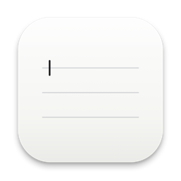

# Minimal Notepad

A lightweight, distraction-free native macOS plain text editor built for immediate launch and frictionless writing without runtime bloat.

Minimal Notepad is a zero-configuration text editor engineered with native AppKit and TextKit 1. It delivers an instant-launch plain text canvas with robust encoding resilience, tabs, search and replace, and native macOS document handling—designed to get out of your way and let you focus entirely on your words and code.

<p align="center">
  
</p>

<p align="center">
  <a href="https://github.com/unamatasanatarai/Minimal-Notepad/releases/latest">
    
  </a>
  
  
  
  
</p>

<p align="center">
  <a href="https://github.com/unamatasanatarai/Minimal-Notepad/releases/latest"><strong>Download Latest Release</strong></a> &bull;
  <a href="#quick-start"><strong>Quick Start</strong></a> &bull;
  <a href="#key-capabilities"><strong>Key Capabilities</strong></a> &bull;
  <a href="#keyboard-shortcuts"><strong>Keyboard Shortcuts</strong></a>
</p>

---

## Why Minimal Notepad?

Most modern text editors have evolved into massive, resource-heavy application suites. They package entire web browser runtimes, run continuous background telemetry, and burden simple note-taking tasks with complex plugin setups, cloud synchronization prompts, and sluggish cold starts.

When you only need to inspect a log file, jot down immediate thoughts, or manipulate plain text, you shouldn't have to wait for heavy application stacks to load.

**Minimal Notepad solves this by returning to the fundamentals of macOS software engineering:**

* **Zero Startup Delay**: Launches directly into a focused editing buffer without template pickers, workspace selection dialogs, or telemetry handshakes.
* **Pure Plain Text Purity**: System typography automatically sanitizes incoming rich-text styling, graphics, and smart substitutions to ensure clean ASCII and UTF-8 output.
* **Complete System Independence**: No runtime daemons, no background analytics, no hidden dotfiles, and zero external dependency trees.

---

## Key Capabilities

### ⚡ Native Tabs and Windows
Documents open as tabs inside the window: one real window however many tabs it holds, so tiling window managers such as yabai treat a new tab as a tab, not as a new window. Drag tabs to reorder them, middle-click a tab to close it, move a tab into its own window, or merge windows back together. `⌘T` opens a new tab and `⌘N` a new window. Each document keeps its own undo history, caret position, zoom and word-wrap setting.

### 💾 Safe Persistence with Unsaved-Change Protection
Edited documents show an asterisk before their name in the tab and window title (untitled ones too), and undoing back to the saved state clears it. Closing or quitting prompts before discarding work, Close All leaves one empty document just like a fresh launch, and quitting needs `⌘Q` pressed twice so a stray keystroke never closes everything. Saving preserves the file's permissions and saves through symbolic links to the real file.

### 🔁 Session Restore and Open Recent
Files that were open when you quit reopen on the next launch. File ▸ Open Recent and the Dock menu list recently used documents.

### 🔍 Find, Replace and Go to Line
`⌘F` opens an inline search bar that highlights every match and shows the match count ("3 of 12"). Use `⌘G` / `⇧⌘G` (or Return / Shift-Return) to step forward and backward, toggle **Match Case**, replace one match or all of them, and jump to any line with `⌘L`.

### 🖥️ Display Options
Toggle word wrap (with horizontal scrolling when it is off), line numbers (on by default) and invisible characters, which show spaces, tabs and line breaks as dimmed `·`, `→` and `↵`. Zoom with `⌘+`, `⌘-` and `⌘0`. The editor follows the system light/dark appearance, or you can force Light or Dark in Settings.

### 🛡️ Resilient Encoding and Line Endings
Opens any regular file, with or without an extension. Text is read as `UTF-8`, falling back to `UTF-16` (when a byte-order mark is present), `Windows-CP1252` and finally `macOS Roman`. Files are saved as UTF-8. Line endings are normalized to LF while editing, and CRLF files are written back with CRLF. New documents use the default line ending chosen in Settings.

### 📂 Drag and Drop
Drop files from Finder onto the editor or the Dock icon to open them in tabs. Dragging selected text within the editor moves it as usual. Directories, pipes and devices are rejected with a clear message.

### ⚙️ Settings (`⌘,`)
Appearance (System / Light / Dark), default line endings, default word wrap, restore previous session, confirm before closing unsaved documents, and optionally save documents when their tab or window loses focus (documents that already have a file).

### 🖨️ Printing
`⌘P` prints the document in black on white at page width, independent of on-screen zoom and appearance, with the native print and PDF dialog.

---

## Product Experience

```text
1. Launch ─────────► Restores your previous session, or opens an empty document
2. Draft / Drop ───► Type freely, open files with ⌘O, or drop them onto the window
3. Edit & Search ──► ⌘F to find, ⌘G to step through matches, ⌥⌘F to replace, ⌘L to jump
4. Organize ───────► ⌘T for a new tab, ⌘N for a new window; drag tabs between windows
5. Save & Print ───► ⌘S to save, ⌘P to print, ⌘Q twice to quit
```

---

## What Makes It Different

| Characteristic | Minimal Notepad | Electron & Multi-Platform Editors |
| :--- | :--- | :--- |
| **Engine Architecture** | Native Swift & AppKit (TextKit 1) | Chromium runtime & Node.js subprocesses |
| **Memory Footprint** | Lightweight single native process | Multi-process browser engine pools |
| **Cold Startup** | Instantaneous single-window launch | Multi-second runtime bootstrapping |
| **Formatting Handling** | Strict plain text; strips rich text & graphics | Rich text parsing by default |
| **External Dependencies** | Zero external frameworks or libraries | Hundreds of vendor packages and modules |
| **Configuration** | Zero setup; launches ready to write | Config files, extension stores, and accounts |

---

## Keyboard Shortcuts

| Shortcut | Action |
| :--- | :--- |
| `⌘N` | New window |
| `⌘T` | New tab |
| `⌘O` | Open… |
| `⌘S` / `⇧⌘S` | Save / Save As… |
| `⌘W` / `⇧⌘W` / `⌥⌘W` | Close Tab / Close Window / Close All |
| `⇧⌘[` / `⇧⌘]` | Previous Tab / Next Tab |
| `⌘P` | Print… |
| `⌘Q` (twice) | Quit |
| `⌘Z` / `⇧⌘Z` | Undo / Redo |
| `⌘X` / `⌘C` / `⌘V` | Cut / Copy / Paste as plain text |
| `⌘A` | Select All |
| `⌘F` | Find |
| `⌥⌘F` | Replace |
| `⌘G` / `⇧⌘G` | Find Next / Find Previous |
| `⌘L` | Go to Line |
| `⌘+` / `⌘-` / `⌘0` | Zoom In / Zoom Out / Actual Size |
| `⌃⌘F` | Full Screen |
| `⌘,` | Settings |

---

## Quick Start

### Download Prebuilt App

1. Download the latest compiled bundle from [GitHub Releases](https://github.com/unamatasanatarai/Minimal-Notepad/releases/latest).
2. Move `Minimal Notepad.app` to your `/Applications` directory.
3. Open the application.

---

## Building from Source

### Prerequisites

* macOS 11.0 (Big Sur) or newer
* Xcode Command Line Tools (`xcode-select --install`)
* GNU Make

### Build and Run

1. Clone the repository:
   ```bash
   git clone https://github.com/unamatasanatarai/Minimal-Notepad.git
   cd Minimal-Notepad
   ```

2. Compile the standalone application bundle:
   ```bash
   make
   ```

3. Launch the compiled application:
   ```bash
   make run
   ```

The compiled binary and macOS app bundle will be placed in `build/Minimal Notepad.app`.

To clean up build artifacts:
```bash
make clean
```

---

## Architecture & Technology

Minimal Notepad is constructed as a single-binary AppKit application:

* **Language**: Swift
* **Document Model**: AppKit document architecture (`NSDocument`, `NSDocumentController`) with tabs drawn inside a single window
* **Text Engine**: TextKit 1 (`NSTextView`, `NSLayoutManager`, `NSTextStorage`) with non-contiguous layout for large files
* **Styling**: System, Light or Dark appearance with native monospaced system typography
* **Packaging**: Standard macOS `.app` bundle generated via shell and GNU Make

---

## License

This project is licensed under the terms of the [MIT License](LICENSE).
